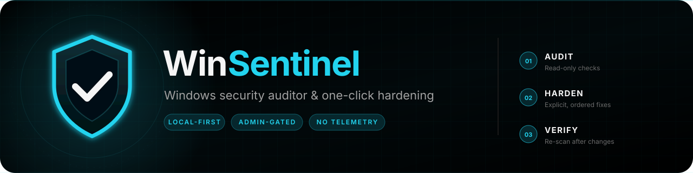
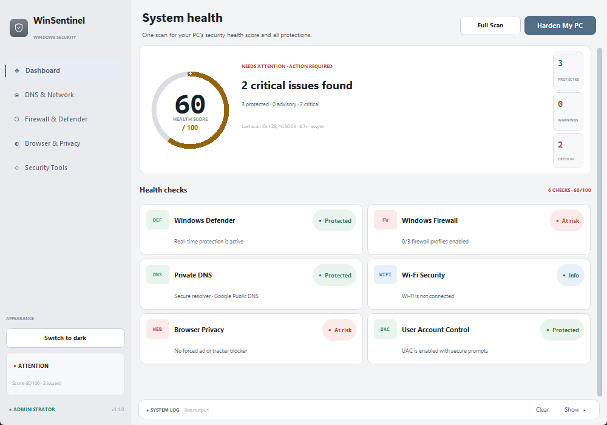
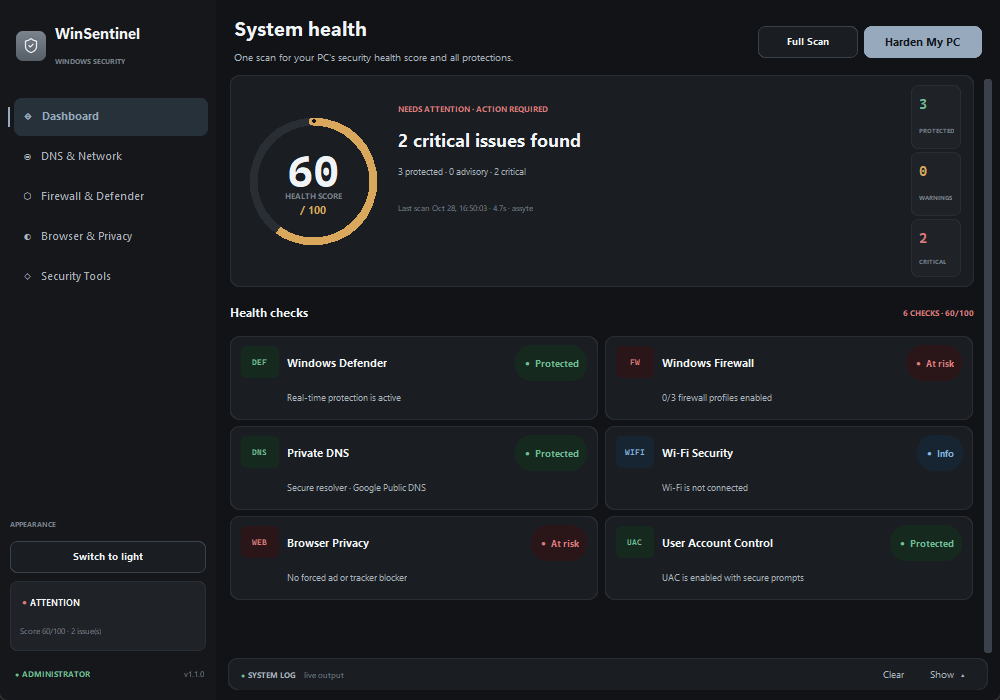
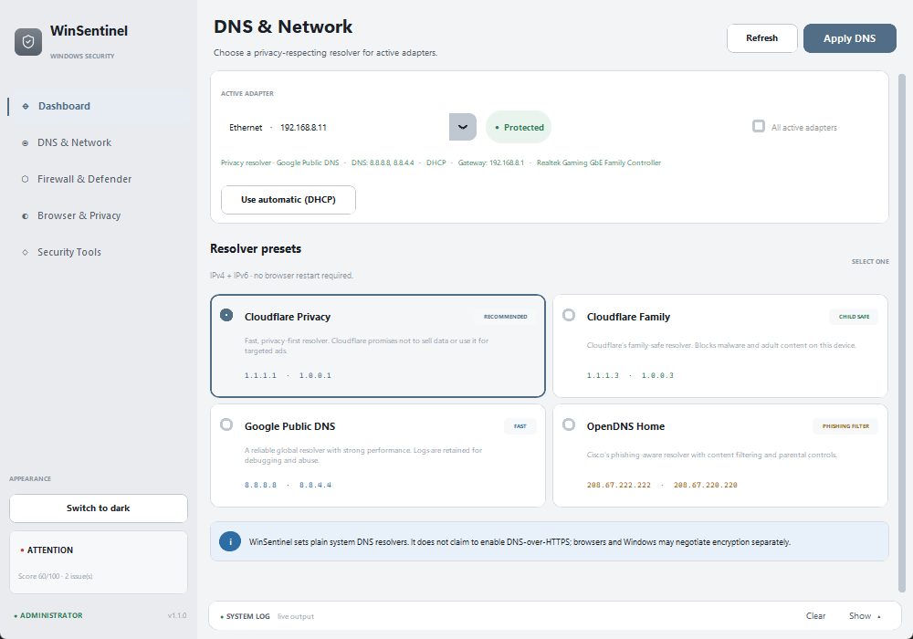
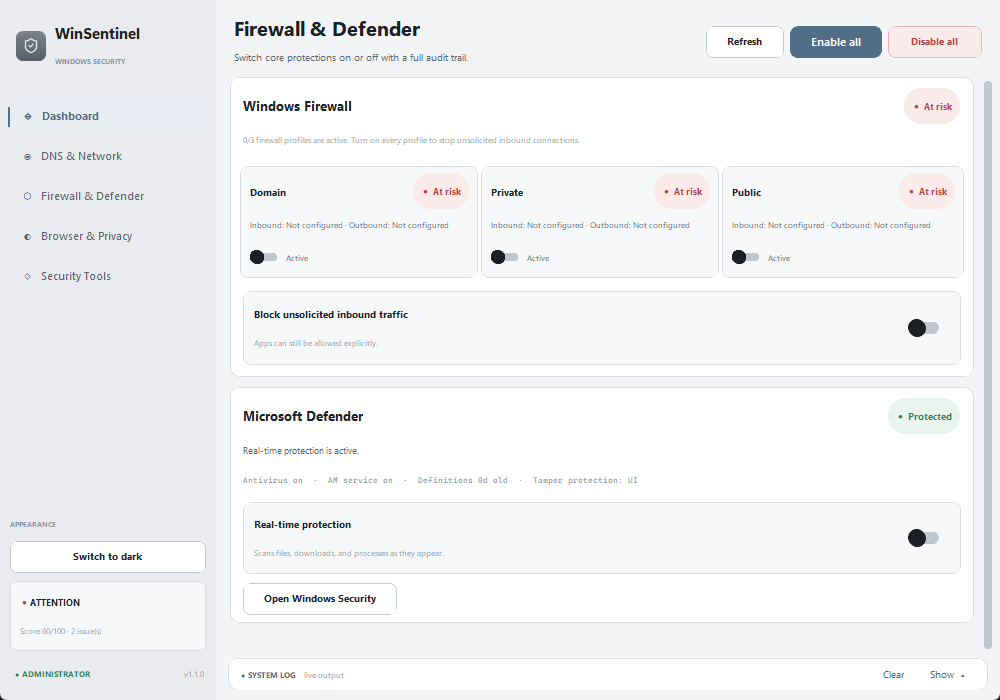
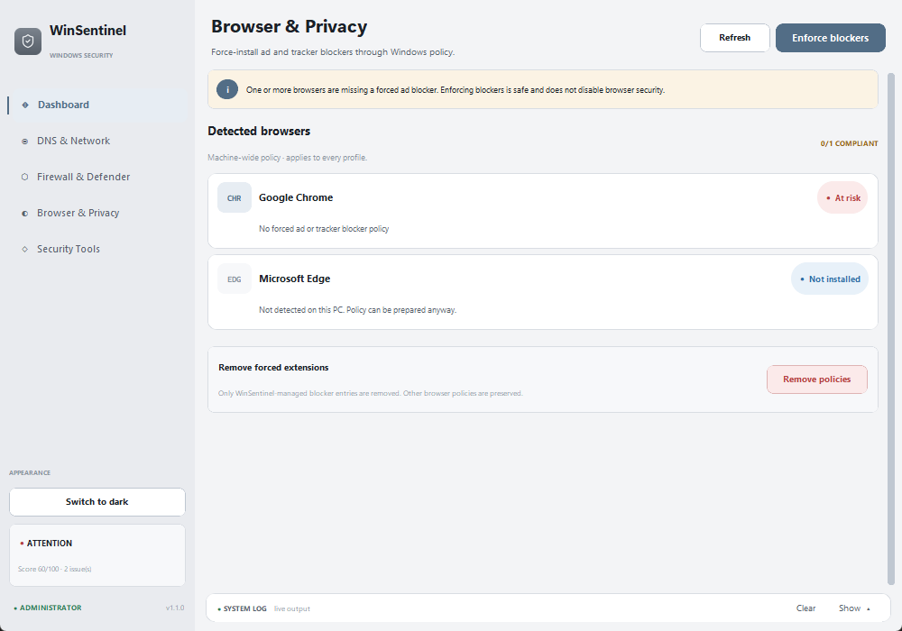
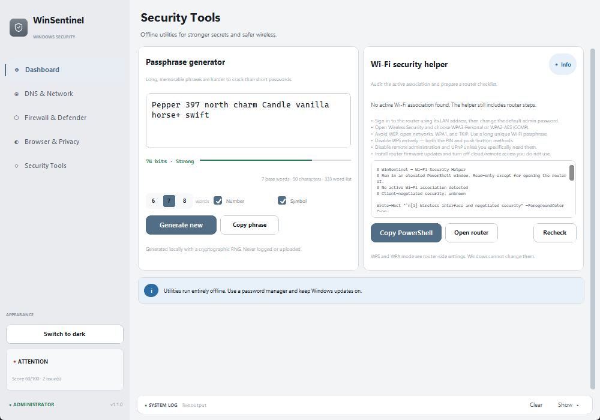
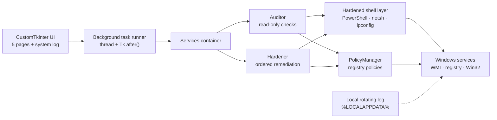

<div align="center">
  
</div>

<h1 align="center">WinSentinel</h1>

<p align="center">
  <strong>Audit Windows security. Understand the gaps. Fix them with one click.</strong>
</p>

<p align="center">
  A local-first Windows security console for the protections that are easy to overlook.
</p>

<p align="center">
  
  
  
  
  <a href="https://github.com/assyte/winsentinel/actions/workflows/ci.yml"></a>
</p>

<p align="center">
  <a href="#quick-start">Quick start</a> ·
  <a href="#screenshots">Screenshots</a> ·
  <a href="#what-it-does">What it does</a> ·
  <a href="#how-it-works">How it works</a> ·
  <a href="#security-model">Security model</a> ·
  <a href="#contributing">Contributing</a>
</p>

WinSentinel is a Windows desktop application built with Python and
[CustomTkinter](https://github.com/TomSchimansky/CustomTkinter). It checks six
security controls, explains the result in plain language, and applies selected fixes
from one dashboard. Everything runs locally: there is no account, cloud backend,
telemetry, background service, driver, or startup entry.

> [!IMPORTANT]
> WinSentinel requests administrator privileges at launch. Its startup scan and page
> navigation are read-only; firewall, Defender, DNS, UAC, and browser-policy changes
> happen only after you press a remediation button or toggle.

> [!NOTE]
> This is a configuration auditor and hardening helper, not an antivirus or a malware
> scanner. It reports the state Windows exposes and never claims a change succeeded
> when Windows rejected it.

---

## At a glance

| | |
| --- | --- |
| **Runs on** | Windows 10 22H2 or newer, Windows 11, x64 |
| **Built with** | Python 3.11+, CustomTkinter 5.2.2, and Pillow |
| **Audit scope** | Microsoft Defender, Windows Firewall, DNS privacy, Wi-Fi security, browser policy, UAC |
| **Interface** | Five pages, compact 1000×700 light/dark window, collapsible system log |
| **Privilege model** | Mandatory UAC elevation and a single-instance mutex |
| **Data** | Local only; no telemetry or cloud account |
| **Distribution** | Run from source or build a one-file PyInstaller executable |
| **License** | MIT |

---

## Screenshots

<p align="center">
  <a href="docs/screenshots/dashboard.png">
    
  </a>
</p>

<p align="center">
  <a href="docs/screenshots/dashboard-dark.png">
    
  </a>
</p>

Dark theme shown above; the page screenshots below use the light theme. The
light/dark switch lives at the bottom of the sidebar and the choice is remembered
locally.

| DNS & Network | Firewall & Defender |
| :---: | :---: |
| [](docs/screenshots/network.png) | [](docs/screenshots/firewall.png) |

| Browser & Privacy | Security Tools |
| :---: | :---: |
| [](docs/screenshots/privacy.png) | [](docs/screenshots/tools.png) |

---

## What it does

- **Audits six controls** — Defender, firewall profiles, DNS privacy, Wi-Fi
  encryption/WPS, browser extension policy, and User Account Control.
- **Scores the posture** — a weighted 0–100 score, a letter grade, a risk headline,
  and pass/warn/fail/unknown counts.
- **Explains the gaps** — every finding includes a summary, evidence, a recommendation,
  and an optional fix action.
- **Hardens with one click** — repairs only the controls that need attention, then
  re-audits to verify the result.
- **Switches DNS** — Cloudflare, Cloudflare Family, Google Public DNS, OpenDNS, or a
  DHCP reset, applied to one adapter or every active adapter.
- **Controls firewall and Defender** — all three firewall profiles, one-click
  enable/disable for every profile, inbound blocking, and Defender real-time protection.
- **Enforces browser privacy** — force-installs uBlock Origin and Privacy Badger for
  Chrome and Edge without replacing unrelated enterprise policies.
- **Provides offline tools** — a CSPRNG passphrase generator and an honest router/Wi-Fi
  hardening helper.
- **Fits your environment** — switch between a neutral light theme and a graphite dark
  theme; the choice is remembered locally.
- **Stays out of the way** — no Windows service, scheduled task, driver, or startup
  shortcut is installed.

### Appearance

The sidebar has one switch between the neutral light theme and the graphite dark
theme. The preference is saved in
`%LOCALAPPDATA%\WinSentinel\settings.json`; it is local-only and contains no
machine or account data.

The muted gray shield mark is based on Lucide's
[`shield-check`](https://lucide.dev/icons/shield-check) icon. The ISC license and
the exact asset provenance are documented in
[`assets/ATTRIBUTION.md`](assets/ATTRIBUTION.md).

### The six controls

| Control | What WinSentinel reads | What counts as healthy |
| --- | --- | --- |
| **Windows Defender** | `Get-MpComputerStatus`, `Get-MpPreference` | Antivirus and real-time protection are enabled |
| **Windows Firewall** | `Get-NetFirewallProfile` | Domain, Private, and Public profiles are on and inbound defaults to Block |
| **Private DNS** | `Get-NetIPConfiguration`, `Get-DnsClientServerAddress` | Every active adapter uses a recognized privacy resolver |
| **Wi-Fi Security** | `netsh wlan show interfaces` | Connected with WPA3 or WPA2-AES and no sign of WPS |
| **Browser Privacy** | Chrome/Edge force-install policy keys | A managed ad blocker and tracker blocker are present |
| **User Account Control** | `EnableLUA`, `ConsentPromptBehaviorAdmin`, `PromptOnSecureDesktop` | UAC is on, admin approval is required, and prompts use the secure desktop |

### Scoring

Each finding has a weight (default `1.0`) and a status value:

| Status | Value | Meaning |
| --- | ---: | --- |
| Pass | 100 | The control is configured as recommended |
| Warn | 50 | The control is partially configured |
| Unknown | 35 | The check could not be completed |
| Fail | 0 | The control is disabled or unsafe |
| Info | ignored | Not applicable, for example no Wi-Fi adapter |

The score is the weighted average of the applicable findings. Informational findings
carry weight `0`, so a disconnected Wi-Fi adapter or an uninstalled browser cannot drag
the score down. Grade labels are **Excellent** (90+), **Good** (75+), **Needs attention**
(60+), **At risk** (40+), and **Critical** (below 40). Letter grades run from **A**
(90+) to **F** (below 60).

A score is a summary, not a guarantee. Open the control cards to see the underlying
evidence.

---

## Requirements

| Item | Requirement |
| --- | --- |
| Operating system | Windows 10 (22H2 or newer) or Windows 11, x64 |
| Python | 3.11 or newer — tested on **3.12.10** |
| Privileges | An account that can approve a UAC prompt |
| Built-in tools | Windows PowerShell 5.1, `netsh`, `ipconfig` |
| Network | Only needed for DNS changes and browser extension downloads |

> WinSentinel is Windows-only. `main.py` exits with a clear message on other platforms.

---

## Quick start

```powershell
git clone https://github.com/assyte/winsentinel.git
cd winsentinel

py -3.12 -m venv .venv
.\.venv\Scripts\Activate.ps1

python -m pip install --upgrade pip
python -m pip install -r requirements.txt

python main.py
```

If PowerShell blocks virtual-environment activation, bypass it for the current shell or
call the interpreter directly:

```powershell
Set-ExecutionPolicy -Scope Process Bypass
.\.venv\Scripts\Activate.ps1

# Or skip activation entirely:
.\.venv\Scripts\python.exe main.py
```

Running the tests does **not** require administrator rights:

```powershell
python -m unittest discover -s tests -v
```

### What happens at launch

1. `main.py` verifies that it is on Windows and handles `--version` / `--help`.
2. If the process is not elevated, it relaunches itself through `ShellExecuteW` with the
   `runas` verb, which produces the standard UAC prompt.
3. If elevation is declined, a native error appears and the app exits. It never silently
   continues in a reduced mode.
4. A named mutex (`Local\WinSentinel.Security.1`) prevents two instances from running.
5. DPI awareness and a theme-aware native title bar are applied.
6. The dashboard starts a read-only audit automatically. No settings change until you
   press a remediation button.

> After changing UAC, Windows requires a sign-out or restart before the new policy is
> active. WinSentinel reports this explicitly.

---

## Auditing and hardening

### One-click hardening

`Harden My PC` runs a fixed, ordered pipeline on a background thread:

1. Defender real-time protection
2. Firewall profiles and inbound blocking
3. Cloudflare DNS on active adapters
4. Browser blocker policies
5. UAC secure defaults
6. Wi-Fi advisory (router-side; no Windows changes)

Controls that are already compliant are skipped. Every step returns its own result, and
the UI reports partial failures instead of pretending everything succeeded. The app
re-audits after the pipeline and displays the verified state.

### Pages

| Page | What you can do |
| --- | --- |
| **Dashboard** | See the health score, risk headline, six control cards, evidence, recommendations, `Full Scan`, and `Harden My PC` |
| **DNS & Network** | Inspect active adapters and current resolvers; apply a preset to one adapter or all adapters; reset to DHCP; flush the resolver cache |
| **Firewall & Defender** | Toggle each firewall profile, enable or disable all profiles at once, block inbound traffic by default, inspect Defender health, and toggle real-time protection |
| **Browser & Privacy** | Detect Chrome and Edge, review every forced-extension entry from HKLM and HKCU, enforce blockers, or remove only WinSentinel-managed entries |
| **Security Tools** | Generate a 4–12 word passphrase with optional number and symbol; inspect Wi-Fi security and open the router admin page |

### DNS presets

| Preset | IPv4 | IPv6 |
| --- | --- | --- |
| **Cloudflare** | `1.1.1.1`, `1.0.0.1` | `2606:4700:4700::1111`, `2606:4700:4700::1001` |
| **Cloudflare Family** | `1.1.1.3`, `1.0.0.3` | `2606:4700:4700::1113`, `2606:4700:4700::1003` |
| **Google Public DNS** | `8.8.8.8`, `8.8.4.4` | `2001:4860:4860::8888`, `2001:4860:4860::8844` |
| **OpenDNS Home** | `208.67.222.222`, `208.67.220.220` | `2620:119:35::35`, `2620:119:53::53` |
| **Automatic (DHCP)** | Restores router/ISP-provided DNS | Restores router/ISP-provided DNS |

IPv4 is applied first; IPv6 is best-effort. The audit treats IPv4 as the source of
truth when an adapter ignores the IPv6 operation.

---

## How it works



### Layers

| Layer | Responsibility |
| --- | --- |
| **UI** (`ui/`) | CustomTkinter pages, cards, gauges, toasts, and the collapsible system log. All long-running work is delegated to the app's task runner. |
| **Services** (`core/services.py`) | Small dependency container wiring the auditor, hardener, DNS manager, firewall manager, policy manager, and passphrase generator. |
| **Audit** (`core/auditor.py`) | Runs the six checks. Each check is isolated; an exception becomes an `unknown` finding instead of crashing the scan. |
| **Remediation** (`core/hardener.py`) | Applies only the fixes that correspond to failed or advisory findings, in a fixed order, and returns per-step results. |
| **System access** (`core/shell.py`) | Executes PowerShell 5.1, `netsh`, and `ipconfig` with explicit arguments, timeouts, hidden consoles, UTF-8 handling, and audit logging. |
| **Policies** (`core/policy_manager.py`) | Reads and writes browser force-install policies and UAC registry values. Browser entries preserve unrelated policies and are reversible. |
| **Models** (`core/models.py`) | Findings, weighted reports, operation results, adapter/firewall/Defender/UAC models, and entropy calculations. |

### Threading and failure handling

The Tk main thread never waits on PowerShell. `WinSentinelApp.run_task()` starts a named
daemon thread and marshals callbacks back to Tk with `after(0, ...)`. A failing check is
converted into an `unknown` finding and added to the report's `errors` list; a failed
operation returns `OperationResult.error(...)` with details.

### What is executed

WinSentinel uses the system PowerShell at
`%SystemRoot%\System32\WindowsPowerShell\v1.0\powershell.exe` with:

```text
-NoLogo -NoProfile -NonInteractive -ExecutionPolicy Bypass -Command <script>
```

Scripts are static except for validated adapter indices, quoted adapter names, and DNS
addresses. The subprocess layer uses an argument list rather than `shell=True`, applies
timeouts, and hides the console window. Commands, exit codes, and remediation results
are written to the local log. Passphrases are never logged.

---

## Safety and reversibility

| Change | How to reverse it |
| --- | --- |
| Firewall profiles (individually or all) or inbound default | Toggle it back on the Firewall page, or use Windows Security |
| Defender real-time protection | Toggle it back, or use Windows Security |
| DNS preset | Select another preset or `Use automatic (DHCP)` |
| Browser extension policy | `Remove policies` on the Browser & Privacy page removes only WinSentinel-managed entries |
| UAC defaults | Restore the previous values manually if required; a sign-out/restart applies changes |
| One-click hardening | Re-audit and reverse individual changes with the controls above |

Browser policies are written under:

```text
HKLM\SOFTWARE\Policies\Google\Chrome\ExtensionInstallForcelist
HKLM\SOFTWARE\Policies\Microsoft\Edge\ExtensionInstallForcelist
```

UAC values are written under:

```text
HKLM\SOFTWARE\Microsoft\Windows\CurrentVersion\Policies\System
```

The audit itself is read-only. No firewall, DNS, Defender, UAC, or registry change is
made during startup, scanning, or page navigation.

> [!WARNING]
> WinSentinel does not create a System Restore point automatically. If you want a full
> rollback option before making several changes, create a restore point first.

---

## Security model

WinSentinel is an elevated desktop tool, so treat it like any other administrator-level
software: review the source and run builds you trust.

- **Mandatory elevation** — no hidden reduced-privilege mode and no silent fallback.
- **Single instance** — a named mutex prevents overlapping operations.
- **No remote code** — the app does not download or execute scripts.
- **No telemetry** — there is no analytics client, account, or cloud sync. Browser
  extension URLs are written to policy; the browser performs the download.
- **Explicit actions only** — the audit reads state; writes happen after a button press.
- **Conservative policy edits** — browser force-install changes append managed entries
  and preserve unrelated values. Removal deletes only WinSentinel-managed IDs.
- **Local logs** — commands and results go to a rotating file; passphrases are excluded.
- **No persistence** — no service, driver, scheduled task, or startup entry.

The Wi-Fi helper does not pretend Windows can change router settings. WPS and WPA mode
live in the router firmware, so the helper inspects the client association, provides a
checklist, and opens the router admin page.

---

## Limitations

WinSentinel is deliberately honest about what Windows can and cannot do.

- **Router settings are not Windows settings.** WPS, WPA2/WPA3 mode, and the Wi-Fi
  passphrase live in the router firmware. Windows exposes no supported `netsh` command
  to change them.
- **DNS presets are plain resolvers.** They change system resolver addresses; they do
  not enable DNS-over-HTTPS or DNS-over-TLS. Windows or the browser may negotiate
  encrypted DNS separately.
- **Browser policy is machine-wide and limited to Chrome/Edge.** It applies to every
  profile. Domain Group Policy can override it. Restart the browser after applying it,
  and check `chrome://policy` or `edge://policy` if an extension does not appear.
- **Extension availability is controlled by the stores.** If Google or Microsoft
  removes an extension, the forced entry cannot install it. uBlock Origin Lite IDs are
  recognized by the audit where Manifest V2 has been retired.
- **Security products can veto changes.** Tamper Protection, third-party antivirus,
  Group Policy, and managed firewalls may reject Defender or firewall changes. The UI
  reports the rejection rather than claiming success.
- **UAC changes need a sign-out.** Writing the registry value is not the same as
  applying it to the current logon session.
- **IPv6 DNS is best-effort.** Some adapters have IPv6 disabled or ignore the `netsh`
  operation; IPv4 verification is the source of truth.
- **WPS is often not exposed by `netsh`.** In that case the audit tells you to verify it
  in the router.
- **This is not an antivirus or a malware scanner.** It audits configuration and
  hardening state.

---

## Logs

The UI keeps a collapsible **System Log** console. The same events are written to:

```text
%LOCALAPPDATA%\WinSentinel\logs\winsentinel.log
```

The file rotates at 2 MB with three backups. Commands, exit codes, audit decisions, and
remediation results are logged. Passphrases are never logged.

---

## Command line

```powershell
python main.py --version
python main.py --help
```

There is currently no headless scan mode; the supported interface is the desktop app.

---

## Development

### Tests

The test suite uses only the standard library and never touches live system settings.
PowerShell/netsh output is replaced with deterministic fakes.

```powershell
python -m unittest discover -s tests -v
```

Current coverage includes:

- score weighting, grades, counts, and operation results
- Wi-Fi parsing (connected, disconnected, localized labels, WPS) and encryption grading
- DNS provider classification
- firewall, Defender, DNS, Wi-Fi, browser, and UAC audit decisions
- audit resilience when an individual check throws
- browser forced-extension parsing and compliance
- passphrase entropy and Wi-Fi helper content
- shell quoting, JSON tolerance, and address validation
- theme preference persistence and light/dark palette integrity

The repository has **71 tests** and a GitHub Actions workflow that runs them on Windows
with Python 3.11 and 3.12.

### Build a standalone executable

Packaging tools are kept out of the runtime requirements.

```powershell
python -m pip install -r requirements-dev.txt
.\build.ps1
```

Or invoke PyInstaller directly:

```powershell
python -m PyInstaller --noconfirm --clean WinSentinel.spec
```

The result is a single windowed executable at `dist\WinSentinel.exe` with an
administrator manifest (`uac_admin=True`). The spec bundles `assets/` and the
CustomTkinter theme data.

The executable is unsigned. Windows SmartScreen may warn on first launch; sign the
binary with your own code-signing certificate before distributing it.

### Project layout

```text
winsentinel/
├── main.py                     # entrypoint, UAC elevation, single instance
├── requirements.txt            # runtime dependencies
├── requirements-dev.txt        # PyInstaller packaging tools
├── WinSentinel.spec            # one-file PyInstaller build
├── build.ps1                   # reproducible build script
├── assets/
│   ├── ATTRIBUTION.md          # Lucide shield-check attribution
│   ├── winsentinel.ico
│   ├── winsentinel.png
│   └── version_info.txt
├── core/
│   ├── auditor.py              # six read-only checks and report assembly
│   ├── constants.py            # colours, DNS presets, browser catalog, policy paths
│   ├── dns_manager.py          # adapter discovery, netsh DNS, DHCP reset
│   ├── firewall_manager.py     # firewall profiles and Defender controls
│   ├── hardener.py             # ordered one-click remediation pipeline
│   ├── logger.py               # rotating file log + UI queue
│   ├── models.py               # findings, reports, results, status scoring
│   ├── policy_manager.py       # browser force-install and UAC registry policy
│   ├── security_tools.py       # passphrase generator and Wi-Fi helper
│   ├── services.py             # dependency container
│   ├── settings.py             # local theme preference
│   ├── shell.py                # hardened subprocess/PowerShell/netsh wrappers
│   ├── winapi.py               # elevation, DPI, title bar, native dialogs
│   └── wordlist.py             # 333-word passphrase list
├── ui/
│   ├── app.py                  # application shell and background task runner
│   ├── components.py           # cards, pills, gauge, sidebar, log console
│   ├── dashboard.py
│   ├── network_page.py
│   ├── firewall_page.py
│   ├── privacy_page.py
│   ├── tools_page.py
│   └── theme.py
├── tests/                      # deterministic, read-only unit tests
├── docs/
│   ├── banner.svg              # repository banner
│   └── screenshots/            # dashboard and page screenshots
├── .github/workflows/ci.yml    # Windows test matrix
├── .gitattributes              # consistent text/binary handling
├── CHANGELOG.md
├── CONTRIBUTING.md
├── SECURITY.md
└── LICENSE
```

---

## Troubleshooting

| Symptom | Fix |
| --- | --- |
| UAC prompt declined | Relaunch and approve it, or right-click `main.py` → Run as administrator |
| “WinSentinel is already running” | Close the existing window; only one instance is allowed |
| No active adapter | Connect to a network with an IPv4 gateway, then press Refresh |
| Defender shows “unavailable” | A third-party antivirus may own the AV role; check Windows Security |
| Firewall change is rejected | Check Group Policy, a third-party firewall, or tamper protection |
| Extension does not appear | Restart the browser; open `chrome://policy` / `edge://policy`; check for domain policy |
| `customtkinter` import error | Run `python -m pip install -r requirements.txt` in the active environment |
| Missing fonts | Segoe UI and Cascadia Mono ship with Windows; Consolas is the fallback |
| Need diagnostics | Open the System Log console or read `%LOCALAPPDATA%\WinSentinel\logs\winsentinel.log` |

---

## Uninstall

1. Remove forced extensions from **Browser & Privacy** if you enabled them.
2. Reset DNS to automatic on **DNS & Network**.
3. Restore any firewall/Defender settings you want to keep.
4. Close WinSentinel and delete the project folder.
5. Optionally delete `%LOCALAPPDATA%\WinSentinel` (logs and the remembered theme).

WinSentinel installs no service, driver, scheduled task, or startup entry.

---

## Contributing

Contributions are welcome. The repository is intentionally small and standard-library
first, so the best changes are focused, tested, and easy to review.

- Read [CONTRIBUTING.md](CONTRIBUTING.md) before opening a pull request.
- Use the [issue tracker](https://github.com/assyte/winsentinel/issues) for bugs and
  feature requests.
- Report security issues privately through the process in [SECURITY.md](SECURITY.md).
- Keep system-changing code behind the existing managers and return `OperationResult`.
- Add deterministic tests for parsing, audit decisions, and policy behavior.
- Never commit tokens, private logs, or machine-specific settings.

### Roadmap

- [ ] Headless `--scan --json` mode for automation
- [ ] DNS-over-HTTPS detection and reporting
- [ ] More browser policy coverage
- [ ] Localization infrastructure
- [ ] Signed release builds
- [ ] A Windows CI smoke test for the packaged executable

If WinSentinel is useful to you, a star helps other people find it.

---

## Changelog

See [CHANGELOG.md](CHANGELOG.md) for release notes and the current roadmap.

## License

[MIT](LICENSE) © 2026 Asete Alan

---

## Disclaimer

WinSentinel is an independent open-source project. It is not affiliated with, endorsed
by, or sponsored by Microsoft Corporation. Windows, Microsoft Defender, Google Chrome,
and Microsoft Edge are trademarks of their respective owners.

Use the application at your own risk. Review the source before running an elevated
build, and keep a recovery path for any security setting you change.
